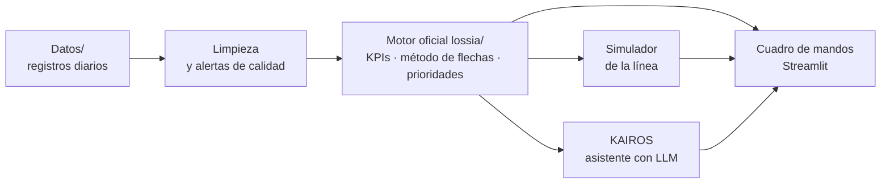

# LOSSIA · Qué máquina frena de verdad la Línea 5 de HORSE Valladolid

Proyecto del Hackathon LOSSIA (HORSE e ICAI, noviembre de 2026). Convierte los registros diarios de
una línea de montaje de motores en tres respuestas que un responsable de línea pueda usar el mismo
día: **qué máquina frena la producción, si la culpa es suya o de sus vecinas, y cuántos motores al
día se ganarían arreglándola.**

## El problema

La Línea 5 de montaje de motores de HORSE en Valladolid encadena **91 operaciones en serie**. Cuando
una se para, el efecto se propaga: la anterior se llena de piezas y se bloquea, y la siguiente se
queda sin piezas y espera. Al final del turno, muchas máquinas aparecen como «paradas» aunque solo
una haya provocado el atasco.

Eso deja al responsable de línea con tres preguntas que los datos en bruto no responden:

1. **¿Quién frena la línea?** La máquina con más horas de parada no tiene por qué ser la que limita
   la producción.
2. **¿Es culpa suya o de su entorno?** Una máquina puede estar parada porque falla o porque sus
   vecinas la dejan sin piezas o la bloquean. Enviar a mantenimiento a la equivocada no arregla
   nada.
3. **¿Qué arreglo primero?** Con recursos limitados, hay que saber cuántos motores al día se ganan
   con cada intervención antes de hacerla.

Además, los datos tienen errores: sensores que cuentan mal, días incompletos u operaciones
duplicadas. Si nadie los detecta, un fallo de un contador parece una avería grave.

## La solución

**LOSSIA** es un cuadro de mandos web con un motor de análisis propio, un simulador de la línea y
un asistente conversacional. Todo comparte los mismos datos y el mismo cálculo:



1. **Limpieza** (`limpieza.py`): depura los registros y deja constancia de cada corrección y de cada
   dato dudoso en `Datos_limpios/` (alertas y registro de limpieza).
2. **Motor de análisis** (`lossia/`): calcula los indicadores, localiza los cuellos de botella con
   el método de flechas y separa las máquinas penalizantes de las que son víctimas de su entorno.
3. **Simulador** (`simulador/`): una réplica de la línea que estima cuántos motores al día se ganan
   con cada mejora.
4. **Cuadro de mandos** (`Streamlit/`): resumen, visualizaciones, detalle por máquina, simulación y
   el asistente KAIROS, filtrable por periodo, días, tipo de operación y tramo de la línea.

## Qué lo hace diferente

### 1. Separa al culpable de la víctima

No basta con ordenar las máquinas por horas de parada. LOSSIA combina dos señales:

- **Método de flechas**: compara cuánto se bloquea cada etapa con cuánto se queda sin piezas. Si
  la anterior la espera y la siguiente se queda sin piezas, esa etapa es un **cuello de botella**, y
  su **severidad** mide cuánto frena el flujo.
- **Cociente TAP/TAI**: parada propia frente a parada inducida por las vecinas. Si es mayor que 1,
  el problema es de la propia máquina.

Una máquina es **penalizante** solo si cumple las dos condiciones. Así, ST_0260 tiene la severidad
más alta de la línea (39 %), pero sus paradas vienen sobre todo de sus vecinas (TAP/TAI 0,38):
mandarla a mantenimiento no resolvería nada. La penalizante real es **PM_2020**.

### 2. Un simulador para decidir, no solo para diagnosticar

El diagnóstico dice quién frena; el simulador dice **qué se gana arreglándolo**. Es una réplica de
eventos discretos de la línea completa:

- cada etapa trabaja a su tiempo de ciclo real y sufre paradas con la frecuencia y la duración
  medias observadas;
- las paradas se propagan solas por la línea a través de buffers de capacidad limitada;
- **reproduce la producción real con menos de un 1 % de error** (1.521 frente a 1.530 motores al
  día);
- compara escenarios con los mismos números aleatorios, de modo que la diferencia entre dos
  escenarios se debe solo a la mejora evaluada.

El resultado cambia la prioridad: eliminar las paradas de **PM_2250** es lo que más producción
añade (+29 motores al día), porque sus paradas son largas y vacían los buffers. Arreglar los cuellos
de botella del método de flechas apenas cambia la producción, porque sus paradas son cortas y los
buffers las absorben. En la web se puede elegir qué etapas mejorar y en qué porcentaje, cambiar el
tamaño de los buffers por tramo y ver una jornada animada.

### 3. KAIROS: un asistente que no se inventa cifras

**KAIROS** responde en lenguaje natural preguntas como «¿Qué máquina frena más la línea?» o «¿Qué
disponibilidad tiene ST-2390?». Está diseñado para un entorno industrial donde una cifra inventada
es inaceptable:

- **Modelo abierto, europeo y local.** Usa Mistral Small 3.2 (24B, licencia Apache 2.0), servido
  con llama.cpp en dos GPU T4. Los datos de la planta no se envían a ninguna API comercial.
- **El modelo no calcula: consulta.** Tiene siete herramientas propias (resumen de la línea,
  indicadores de una etapa, prioridades, cuello de botella, mantenimiento, alertas y glosario) que
  llaman al mismo motor oficial que el cuadro de mandos. Responde sobre el mismo periodo y los
  mismos filtros que estés viendo.
- **Verificación de cada cifra.** Antes de mostrar una respuesta, un verificador comprueba que
  cada número sale de los datos consultados **y corresponde a la máquina, al indicador y a la
  unidad de los que habla la frase**. Así no da por bueno, por ejemplo, el tiempo de ciclo de una
  máquina presentado como su disponibilidad. Cada respuesta muestra el sello «Cifras verificadas»
  o señala qué cifras no se pueden respaldar, y explica de dónde salen los datos.
- **Respuestas directas.** Las preguntas sencillas se resuelven sin rondas extra con el modelo.
- **No rompe el resto.** Si el servidor del modelo no está disponible, el cuadro de mandos sigue
  funcionando y KAIROS lo indica.

### 4. Datos en los que se puede confiar

- La limpieza genera **alertas visibles en la web**. Por ejemplo, ST_2235 registra unas 22.000
  paradas al día y un 20 % de disponibilidad, pero su contador de piezas no es fiable ningún día y
  la línea produce con normalidad: apunta a un fallo del sensor, no de la máquina.
- Un **único motor de cálculo** alimenta la web, el simulador y el asistente, de modo que todos
  dan las mismas cifras. Las pruebas de `tests/` comprueban que el cálculo en vivo coincide con los
  resultados persistidos y que el asistente verifica bien.

## Resultados principales

| Hallazgo | Detalle |
|---|---|
| Máquina más penalizante | **PM_2020**: cuello de botella con severidad del 18 % y TAP/TAI de 2,4; penalizante principal 8 de 16 días |
| Segunda penalizante | **ST_0261** (TAP/TAI 1,3) |
| Falsa alarma | **ST_0260**: mayor severidad (39 %), pero víctima de su entorno (TAP/TAI 0,38) |
| Fallo de sensor, no de máquina | **ST_2235**: contador de piezas no fiable |
| Mejora con más impacto (simulación) | **PM_2250**: +29 motores al día si se eliminan sus paradas |

**Conclusión:** el método de flechas sirve para **diagnosticar** qué máquina frena el flujo y si la
culpa es suya o de su entorno; el simulador sirve para **decidir** qué arreglar primero y cuánto se
gana.

## Datos

- Línea 5 de montaje, 91 operaciones, del 29/09/2026 al 23/10/2026 (16 días con datos).
- Por cada operación y día: tiempo funcionando (TBF), parada propia (TAP), desabastecimiento (DES),
  saturación (SAT), número de paradas (NAP) y piezas producidas (NPR).
- Originales en `Datos/`; datos depurados, alertas y registro de la limpieza en `Datos_limpios/`.

## Metodología

### Indicadores

| Indicador | Definición | Objetivo |
|---|---|---|
| Dp (disponibilidad propia) | TBF / (TBF + TAP) | ≥ 90 % |
| Tcy (tiempo de ciclo) | TBF / NPR, en centiminutos por pieza | ≤ 80 cmin |
| Fpm (frecuencia de paro) | NAP / NPR × 1000 | — |
| TAI (parada inducida) | DES + SAT: tiempo parada por culpa de las vecinas | — |
| TAP / TAI | Parada propia frente a parada inducida | > 1 = el problema es de la propia máquina |

Las operaciones en paralelo se fusionan en una sola etapa. Los umbrales están en `lossia/config.py`.

### Cuellos de botella y máquinas penalizantes

- **Método de flechas** (`lossia/determinista.py`): compara cuánto se bloquea cada etapa con cuánto
  se queda sin piezas. Una etapa es cuello de botella cuando las flechas de sus vecinas convergen en
  ella; la **severidad** mide cuánto frena el flujo.
- **Criterio de HORSE**: un cuello es **penalizante** si su severidad supera el 5 % y su cociente
  TAP/TAI es mayor que 1. Si no, es una víctima de su entorno.
- En la web, el ranking de cuellos se ordena por **severidad × TAP/TAI**.

### Simulador

Réplica de eventos discretos de la línea (`simulador/simulador_linea.py`):

- Cada etapa trabaja a su tiempo de ciclo y sufre paradas con la frecuencia y la duración medias
  reales; las paradas se generan al azar con esas medias.
- Entre etapas hay buffers de capacidad limitada. Su tamaño no viene en los datos y se ha calibrado
  en 8 piezas para reproducir la producción real.
- Las cifras de producción son la media de 5 jornadas simuladas, con los mismos números aleatorios
  en todos los escenarios.

El simulador no reproduce un día concreto: sirve para **comparar escenarios** (qué ocurre si se
reducen las paradas de una o varias etapas, o si cambia el tamaño de un buffer).

### Análisis avanzado

`analisis_avanzado/` reúne estudios complementarios: el análisis de penalizantes, un módulo genérico
de cuellos de botella aplicable a otras líneas y una prueba de concepto de **predicción diaria de
averías**. Esta última combina un modelo de desgaste (Weibull), las señales previas de la línea
(microparadas, caída de Dp y Tcy) y un clasificador, y genera un informe de riesgo para el relevo de
turno.

## Cuadro de mandos web

| Pestaña | Contenido |
|---|---|
| Resumen | Alertas de calidad de datos, insights principales y cifras de la línea |
| Visualizaciones | Reparto del tiempo, top penalizantes, evolución de objetivos y parada propia frente a inducida |
| Simulación | Animación de una jornada, mejora de una o varias etapas y tamaño de buffer por tramo |
| Máquinas | Detalle de cada etapa: indicadores, categoría, motivo de prioridad y evolución diaria |
| Datos | Tabla completa con descarga en CSV |

La barra lateral filtra por centro, línea, periodo, días de la semana, tipo de operación, tramo y
máquinas. **KAIROS** es el botón flotante de abajo a la derecha.

## Estructura del repositorio

```text
Streamlit/            Cuadro de mandos web
  app.py              Aplicación principal
  graficos.py         Gráficos de las visualizaciones
  lossia.css          Estilos
  requirements.txt    Dependencias
lossia/               Motor de análisis oficial
  datos.py            Carga y agregación por etapa
  kpis.py             Dp, Tcy, Fpm y paradas
  determinista.py     Método de flechas, severidad y criterio TAP/TAI
  prioridades.py      Ranking de prioridades y de mantenimiento
  interfaz.py         Punto de entrada para la web y el chat
  config.py           Umbrales y rutas
simulador/            Simulador de eventos discretos y animación de la línea
chat/                 Asistente KAIROS: herramientas, verificador y conexión con el modelo
analisis_avanzado/    Penalizantes, cuellos de botella genérico y predicción diaria de averías
presentacion/         Presentaciones y guion para el jurado
Datos/                Datos originales del reto
Datos_limpios/        Datos depurados, alertas y registro de la limpieza
Resultados/           Indicadores y rankings calculados por analisis.py
tests/                Pruebas del motor y del asistente
Informacion_RETO/     Presentación oficial del reto
docs/                 Documentación de apoyo (referencia de estilo de la web)
limpieza.py           Limpieza de los datos originales
analisis.py           Cálculo de todos los resultados
01_limpieza.ipynb     Limpieza paso a paso
02_eda.ipynb          Análisis exploratorio
03_llm_kaggle.ipynb   Servidor del modelo de lenguaje en Kaggle
04_demo_remota.ipynb  Demo remota del asistente
```

## Instalación y uso

Requisitos: Python 3.10 o superior.

```bash
pip install -r Streamlit/requirements.txt
```

Orden de ejecución desde la raíz del repositorio:

```bash
python limpieza.py                     # 1. Datos/ -> Datos_limpios/
python analisis.py                     # 2. Datos_limpios/ -> Resultados/
streamlit run Streamlit/app.py         # 3. Cuadro de mandos web
```

Los pasos 1 y 2 solo son necesarios si cambian los datos: `Datos_limpios/` y `Resultados/` ya están
en el repositorio.

Otros comandos:

```bash
python simulador/simulador_linea.py --buffer 8          # ranking de motores/día ganados por etapa
python simulador/animacion_linea.py --mejorar PM_2250   # animación HTML de una jornada
python analisis_avanzado/predictor_fallos_diario.py --dia S43-D4   # informe de riesgo de un día
python -m pytest tests                                  # pruebas
```

### Conexión del asistente KAIROS

KAIROS necesita un servidor del modelo compatible con la API de OpenAI. `03_llm_kaggle.ipynb`
levanta Mistral Small 3.2 en Kaggle (dos GPU T4) y `04_demo_remota.ipynb` lo publica con un túnel
temporal. La conexión se configura en `.streamlit/secrets.toml`:

```toml
LLM_BASE_URL = "https://<servidor>/v1"
LLM_MODEL    = "<nombre del modelo>"
LLM_API_KEY  = "<clave>"
```

Sin conexión, el resto del cuadro de mandos funciona con normalidad y KAIROS lo indica. Más detalle
en `chat/README.md` y `chat/REMOTO.md`.

## Limitaciones

- 16 días de datos: los resultados son robustos para el periodo, pero no permiten estudiar
  tendencias largas.
- Tres operaciones (ST_0295, ST_2235 y ST_3300) tienen el contador de piezas no fiable, así que no
  tienen tiempo de ciclo ni frecuencia de paro.
- El simulador supone paradas independientes con duración exponencial y tiempo de ciclo constante;
  el tamaño de los buffers está calibrado, no medido, y las operaciones en paralelo se tratan como
  una sola etapa.
- La reproducción de las esperas por etapa (DES y SAT) es moderada, aunque la producción total
  coincide con la real.
- KAIROS verifica las cifras, no el razonamiento: una frase con cifras correctas puede ser
  engañosa. Por eso cada respuesta indica de qué datos sale.
- El servidor del modelo en Kaggle es adecuado para una demo, no para producción: la sesión dura
  como máximo 12 horas y la dirección del túnel cambia en cada sesión.

## Equipo

- **Alonso**: limpieza de datos y motor de análisis.
- **Gonzalo**: cuadro de mandos web y simulador.
- **Miguel**: asistente KAIROS e integración.
- **Jorge**: análisis avanzado y presentación.
